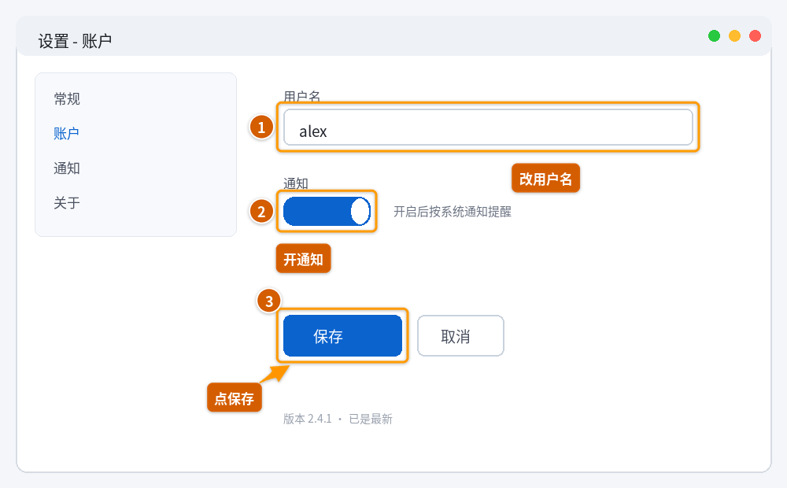
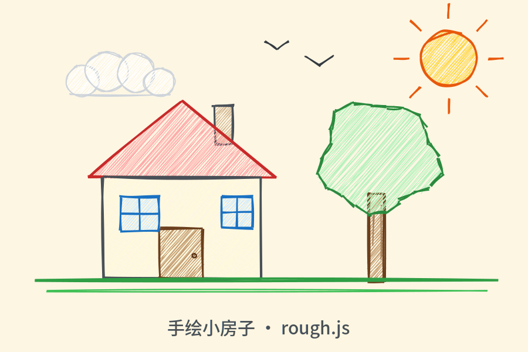

# image-annotate — 让 AI 智能体自己画图 / 标注图片

> 让 AI 智能体**自己出图**：从零画手绘插画 / 示意图 / 流程图，或在已有截图上
> 画数字步骤、圈框、箭头、高亮、放大镜、实心打码。
> 两条路线都**吃 JSON、吐 PNG**，装完即用。



---

## 一、这是什么

| 路线 | 手感 | 适合 |
|---|---|---|
| **A. 精确标注**（ainotate） | 现代 UI 风：数字步骤 ①②、圈框、箭头、高亮、聚光、放大镜、实心打码 | 截图讲解「点这里」、bug 报告、操作步骤图 |
| **B. 手绘涂描**（rough.js） | 人拿笔的感觉：抖动线条、歪框、手绘箭头、铅笔草图 | 示意图 / 草图、圈注、白板讲解、插画 |




---

## 二、安装（3 步）

### 1. 装系统依赖

```bash
# Debian / Ubuntu
sudo apt-get install -y libcairo2 fonts-noto-cjk
```

- `libcairo2` —— cairosvg 渲染必需，不装会渲染失败
- `fonts-noto-cjk` —— 中文字体，不装中文会变**豆腐块**
- 其他发行版用对应包名（如 Arch 的 `cairo` + `noto-fonts-cjk`、Fedora 的 `cairo` + `google-noto-sans-cjk-fonts`）

### 2. 放进技能目录

**DeepSeek Harness**：放到 `~/.dsh/skills/image-annotate/`（推荐直接解压到位）

```bash
git clone https://github.com/lumanlight/image-annotate.git ~/.dsh/skills/image-annotate
```

> 目录名必须是 `image-annotate`，且 `SKILL.md` 要在目录根下——智能体靠这个识别技能。
>
> 用别的智能体平台（Claude Code / Cursor / OpenCode 等）也同理：
> 把 `image-annotate/` 整个目录放进该平台的 skills 目录即可，
> 只要平台按「目录 + SKILL.md frontmatter」这套规则加载技能就能用；
> 不吃这套规则的平台，也可以把 `scripts/` 当普通命令行工具直接调。

### 3. 重建运行环境

```bash
cd ~/.dsh/skills/image-annotate
bash setup.sh
```

> 也可下载整包：仓库根目录的 Release 里提供 `image-annotate-share.tar.gz`。

`setup.sh` 会检查系统依赖、按 `requirements.txt` 建好虚拟环境并装上
`ainotate` / `rough` / `cairosvg`。有 `uv` 用 uv，没有就退回标准库 `python3 -m venv` + pip。

**必须重建 venv**：`venv/` 是跟机器和 CPU 架构绑定的，不能跨机器拷贝。

---

## 三、用起来

### A. 让智能体画

直接对智能体说「画个……」「画一张流程图……」「把这个圈出来」，
它会加载本技能并调用自带脚本。你也可以手动调：

```bash
BD=~/.dsh/skills/image-annotate

cat > /tmp/scene.json <<'JSON'
{"w":600,"h":400,"bg":"#fdf6e3","items":[
 {"type":"circle","x":480,"y":90,"diameter":80,"stroke":"#e8590c","strokeWidth":3,"roughness":1.4,"fill":"#ffd43b"},
 {"type":"rect","x":120,"y":200,"w":220,"h":140,"stroke":"#495057","strokeWidth":3,"roughness":1.3,"fill":"#fff9db"},
 {"type":"polygon","points":[[100,200],[230,110],[360,200]],"stroke":"#c92a2a","strokeWidth":3,"roughness":1.3,"fill":"#ffa8a8"},
 {"type":"text","x":150,"y":370,"text":"手绘小房子","size":28,"color":"#495057"}]}
JSON

"$BD/scripts/sketch" /tmp/scene.json ./house.png
```

### B. 让智能体标截图

```bash
cat > /tmp/spec.json <<'JSON'
{"input":"/绝对路径/shot.png","marks":[
 {"type":"step","n":1,"rect":[360,138,880,184],"label":"改用户名"},
 {"type":"step","n":2,"rect":[360,250,470,286],"label":"开通知"},
 {"type":"arrow","rect":[360,400,510,452],"label":"点保存"}]}
JSON

"$BD/scripts/annotate" annotate /tmp/spec.json --json
```

输出默认落在 `./image-annotate-out/`。

**坐标必须是图片真实像素**，别照缩略预览目测：

```bash
"$BD/scripts/annotate" info shot.png              # 真实尺寸
"$BD/scripts/annotate" grid shot.png              # 叠坐标网格
"$BD/scripts/annotate" zoom shot.png x1 y1 x2 y2  # 局部放大+细网格
```

---

## 四、目录结构

```
.
├── SKILL.md              # 智能体读的说明书（frontmatter + 速查）
├── setup.sh              # 换机器时重建 venv
├── requirements.txt      # ainotate==0.1.9 / rough==1.6 / cairosvg==2.9.1
├── LICENSE / NOTICE      # 本仓 MIT；第三方许可见 NOTICE
├── scripts/
│   ├── sketch            # 从零画（rough.js 手绘风）
│   ├── sketch_render.py  # sketch 的渲染实现
│   └── annotate          # 在已有图上标（ainotate）
├── references/
│   ├── scene-grammar.md     # scene JSON 全量语法
│   ├── drawing-recipes.md   # 太阳/云/树/房子/流程图/有机形状配方
│   └── annotate-spec.md     # 所有 mark 类型与字段
└── demos/                # 示例图 + 示例 JSON（可直接跑）
```

---

## 五、常见报错

| 报错 / 现象 | 原因与解法 |
|---|---|
| 中文变方块 | 没装 `fonts-noto-cjk`，或没走 `scripts/annotate` 封装 |
| `Read-only file system` | 输出目录不可写 → 显式给输出路径，或设 `AINOTATE_OUTPUT_DIR=$PWD/xx` |
| `missing 'input'` | 标注 spec 根字段是 `input`，不是 `image` |
| `rect lies mostly outside` | 用了预览尺寸 → `annotate info` 拿真实像素 |
| `no room for label 'X'` | label 写短 / 加 `label_at:[x,y]` / 裁大图 |
| `No module named rough/ainotate` | 没建 venv → 跑 `bash setup.sh` |
| 图形跑到别处 / 巨大 | 自己写代码却漏了 `auto_fit=False` |
| 树冠/云像棒棒糖 | 别堆一堆圆，改用**一条闭合 polygon** |

---

## 六、许可与出处

- 本包内自研脚本（`scripts/`、`references/`、`setup.sh`）可自由取用。
- 上游依赖：
  - [ainotate](https://pypi.org/project/ainotate/) 0.1.9 —— **AGPL-3.0**
  - [rough](https://pypi.org/project/rough/) 1.6（rough.js Python 移植）
  - cairosvg 2.9.1
- `demos/` 里的界面图为**虚构示例**，不含任何真实数据。
- 第三方依赖的许可义务见 [NOTICE](NOTICE)。

> 提示：ainotate 是 AGPL-3.0，做闭源分发前请自行确认合规。
